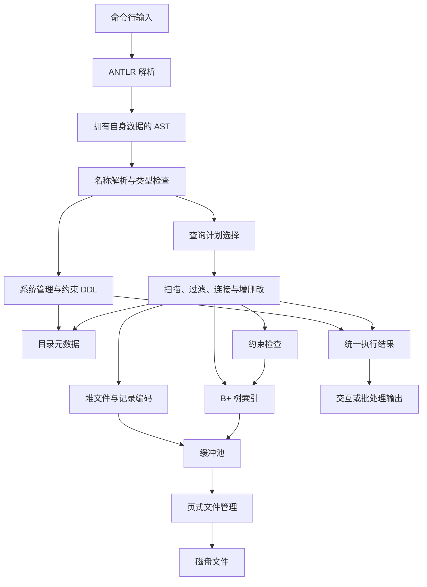

# 从页式存储到 SQL 执行：学生开发者的数据库实现手册

适用项目：单用户、多数据库的关系型数据库管理系统实验。参考语言：C++17。资料核对日期：2026-10-09。

本手册以 [THU 数据库系统概论实验教程](https://thu-db.github.io/dbs-tutorial/) 为需求依据，把模块介绍进一步展开成可执行的开发步骤。读者应了解基本 SQL、数组、链表、树、哈希表和文件读写；不要求事先实现过编译器或数据库。

**文中的“课程约定”来自官方资料，“建议方案”是本手册给出的工程设计。** 接口和二进制布局是设计草图，并非附件代码的原样接口，也不是已经完成、编译验证的实现。课程评分、测例与学期安排以教学组最新公告为准。文法能解析某个功能，不代表该功能属于必做范围。

## 阅读导航

1. [目标与需求边界](#目标与需求边界)
2. [开发顺序与完成标准](#开发顺序与完成标准)
3. [系统架构与模块职责](#系统架构与模块职责)
4. [工程环境与目录](#工程环境与目录)
5. [公共类型与二进制编码](#公共类型与二进制编码)
6. [页式文件管理](#页式文件管理)
7. [缓冲池与页面生命周期](#缓冲池与页面生命周期)
8. [定长记录与堆文件](#定长记录与堆文件)
9. [变长记录与空间管理](#变长记录与空间管理)
10. [磁盘 B+ 树索引](#磁盘-b-树索引)
11. [目录元数据与 DDL](#目录元数据与-ddl)
12. [完整性约束与写入一致性](#完整性约束与写入一致性)
13. [SQL 解析与语义绑定](#sql-解析与语义绑定)
14. [扫描算子与查询计划](#扫描算子与查询计划)
15. [连接算法与多表查询](#连接算法与多表查询)
16. [增删改的执行流程](#增删改的执行流程)
17. [命令行协议与批量导入](#命令行协议与批量导入)
18. [选做功能与优化路线](#选做功能与优化路线)
19. [测试与验收](#测试与验收)
20. [性能分析与故障定位](#性能分析与故障定位)
21. [协作、报告与最终检查](#协作报告与最终检查)
22. [术语速查](#术语速查)

建议第一次通读目标、架构和命令行协议；之后按照开发顺序推进。遇到某个底层问题时，回到对应章节的不变量和失败情形，而不是只阅读伪代码。

<a id="目标与需求边界"></a>
## 1. 目标与需求边界

### 1.1 最终要交付什么

课程的目标是从磁盘数据组织出发，实现可接收 SQL、管理多个数据库、完成关系数据操作的单用户 DBMS。核心模块包括记录、索引、系统管理和查询处理；页式文件管理可以自行实现，也可以使用附件参考代码。解析器可以利用给定文法生成。[官方依据：实验概述](https://thu-db.github.io/dbs-tutorial/chapter-0/0-1-intro/)

在工程上，一个可验收的最小系统应该形成以下闭环：

```text
启动程序 → CREATE DATABASE → USE → CREATE TABLE
        → INSERT / LOAD → SELECT / UPDATE / DELETE
        → 正常退出 → 再次启动 → 查询仍然存在的数据
```

SQL 正确、文件能读、程序能编译分别只是局部完成。只有上面这条链路全部可用，学生才能真正验证各层接口是否配合正确。

### 1.2 需求对照表

| 项目 | 基础实现应覆盖 | 实现建议与范围提醒 |
| --- | --- | --- |
| 使用场景 | 单用户、多数据库 | 单进程顺序执行足够；先完成生命周期管理 |
| 数据类型 | `INT`、`FLOAT`、`VARCHAR(n)` | 分别采用 `int32_t`、`double`、有长度限制的字符串 |
| 字符串存储 | 定长或变长均可 | 首版选择定长；变长另设布局，不混用解码器 |
| 记录操作 | 插入、读取、删除、更新、扫描 | 记录以 RID 标识；把行编码和页操作分开 |
| 索引 | 整数列及整数列组合的 B+ 树 | 单独的磁盘文件；修改表时同步维护 |
| 约束 | 主键、外键及组合约束 | 被引用列是主键；基础主外键类型为整数 |
| 基础条件 | 比较、`AND` | 同一比较器贯穿全表扫描、索引和约束 |
| 连接 | 两表等值连接 | 使用逗号分隔的隐式连接；多表连接列为选做 |
| 系统管理 | 数据库、表、索引和约束的管理 | `ALTER` 约束操作也要检查已有数据 |
| 运行方式 | 交互、批处理、两种导入入口 | 前端格式化器独立于后端执行逻辑 |
| 重启 | 正常退出后保持数据 | 明确刷新顺序；课程不要求崩溃一致性 |

类型和记录长度依据 [记录管理概述](https://thu-db.github.io/dbs-tutorial/chapter-2/intro/)；索引、主外键类型依据 [索引管理概述](https://thu-db.github.io/dbs-tutorial/chapter-3/intro/)；基础与选做的测试边界参见 [CI 平台说明](https://thu-db.github.io/dbs-tutorial/ci/platform/)。

聚合、分组、排序、模糊匹配、嵌套查询、多表连接及其优化、`UNIQUE`、日期和完整 NULL 功能属于需要单独核对的选做路线。NULL 位图从首版预留很便宜，即使尚未完成 NULL 选做，也应避免把 NULL 混同于整数 0 或空字符串。不要依据 `SQL.g4` 中出现了 `GROUP BY`，就把完整聚合实现列为首版依赖。

### 1.3 文法兼容性比“像 MySQL”更重要

官方后端举例包含一些展示性的 MySQL 写法。实现前应逐条对照附件文法：实际附件使用表级 `PRIMARY KEY (...)`；`INSERT` 基础语法不指定列；连接使用 `FROM A,B WHERE A.x=B.y`；`UPDATE` 文法要求 `WHERE`。正文示例均按核对过的附件形式编写。[官方依据：后端约定](https://thu-db.github.io/dbs-tutorial/chapter-0/0-2-backend/)、[文法解释](https://thu-db.github.io/dbs-tutorial/explanation/intro/)

下列语句作为本手册的基础模型：

```sql
CREATE TABLE student (id INT NOT NULL, name VARCHAR(32) NOT NULL, age INT, gpa FLOAT, PRIMARY KEY (id));
CREATE TABLE course (id INT NOT NULL, title VARCHAR(32) NOT NULL, PRIMARY KEY (id));
CREATE TABLE enrollment (student_id INT NOT NULL, course_id INT NOT NULL, grade FLOAT, PRIMARY KEY (student_id, course_id), FOREIGN KEY fk_enrollment_student(student_id) REFERENCES student(id), FOREIGN KEY fk_enrollment_course(course_id) REFERENCES course(id));
```

这里所有主外键都是整数，组合主键也完全由整数组成，适合基础实现。

### 1.4 资源约束如何影响设计

官方当前运行说明给出约 3600 秒、256 MB 内存、10 GB 磁盘和一个 CPU 核的运行约束；查询结果的约定大小不超过 32 MB。数据目录应位于运行工作目录之下；测试期间可能正常退出并重启进程。[官方依据：运行要求](https://thu-db.github.io/dbs-tutorial/ci/run/)

建议先使用 64 MiB 缓冲池，为解析器、行对象、查询临时空间、标准库和运行时保留余量。后续通过实测增加到 96 或 128 MiB。不要把“最终结果不超过 32 MB”理解成“连接中间结果也不会超过 32 MB”，也不要把逻辑数据大小直接等同于 `vector<Row>` 的实际内存。

运行说明采用虚存限制，因此测量时同时关注进程虚拟地址空间和常驻内存，例如 Linux 的 VmSize/VmPeak 与 RSS；只看 RSS 低于 256 MB 并不足以证明满足约束。解析库、线程栈和分配器预留都可能增加虚拟空间。

数据规模说明涉及不同边界：记录管理章节对基础记录各列最大长度之和给出 2048 字节限制；FAQ 另外描述表数、列数、列名、单列长度和总数据量。实现布局时以完整记录长度检查为准，并保留越界报错。[规模参考：FAQ](https://thu-db.github.io/dbs-tutorial/faq/)

<a id="开发顺序与完成标准"></a>
## 2. 开发顺序与完成标准

### 2.1 推荐里程碑

| 阶段 | 具体产物 | 完成标准 |
| --- | --- | --- |
| M0 协议骨架 | 参数解析、读取 SQL、结果结构、输出器 | 空表、错误、`rows=0`、EOF 均可稳定处理 |
| M1 页与缓冲池 | 页式 I/O、缓存、刷新与关闭 | 多文件、淘汰脏页、关闭重开后字节一致 |
| M2 记录 | 行编码、槽位、RID、扫描 | 跨多页插入；删后复用；改后重开数据正确 |
| M3 最小 SQL 闭环 | 数据库、表、全表扫描、增删改 | [最小示例](../examples/mvp.sql)产生预期结果，不依赖索引、约束或连接 |
| M4 索引 | B+ 树、建索引、索引扫描 | 分裂、借位、合并、重复键和范围边界正确 |
| M5 约束 | 主键、外键、反向依赖、约束 DDL | 非法写入后表和索引完全保持合法状态 |
| M6 连接与导入 | 两表连接、两种导入、索引维护 | 能处理大于内存的数据，不全表驻留内存 |
| M7 基础验收 | 官方本地测试、重启、资源测量 | 所有基础 flags 实际启用并通过 |
| M8 选做 | 每次一个独立功能 | 新测例通过，基础功能回归通过 |

先让全表扫描完成所有基本 DML，再增加索引，可以把查询正确性和树结构正确性分别验证。解析器和批处理输出应提前接入，因为集成测试会穿过整个系统。

M3 使用 mvp 示例独立验证；完成 M4～M6 后再执行 [完整基础示例](../examples/smoke.sql)。后者包含主外键、显式索引和两表连接，适合模块集成验收。

### 2.2 每个模块交付四样东西

1. 接口：参数、返回值、错误、资源所有权和有效期。
2. 不变量：任何公开操作前后必须成立的条件。
3. 最小验证：能区分“看起来能运行”与“确实正确”的边界输入。
4. 调试信息：页号、RID、树结构或执行计划等可观察证据。

例如缓冲池的接口返回页保护对象，不变量是被保护的页不可淘汰，验证是三帧缓存读写十页，调试信息是命中、淘汰和脏页写回计数。

### 2.3 时间紧张时的取舍

先保证持久化、完整性约束、CSV 输出和真正的索引访问；这些错误会使大量上层测例一起失败。基础功能没有闭环前，暂停 GUI、并行执行、自定义网络协议、复杂代价模型和多用户事务等扩展。

若小组有三人，可分别负责存储与记录、索引与约束、解析与执行；但每位开发者都应独立跑通一个 SQL 从输入到磁盘的路径。目录元数据和接口约定需要共同维护，不能等集成时再协商页号含义。

<a id="系统架构与模块职责"></a>
## 3. 系统架构与模块职责

### 3.1 一条 SQL 的处理路径



此图是本手册的建议分层。目录元数据既服务 DDL，也提供 DML 所需 schema；它并不只是一个命令行变量。

### 3.2 模块边界

| 模块 | 输入与输出 | 主要职责 | 应避免的依赖 |
| --- | --- | --- | --- |
| FileManager | 文件 ID、页号、页字节 | 精确读写、文件创建关闭 | SQL、列类型 |
| BufferPool | 页面定位、PageGuard | 页驻留、pin、dirty、替换 | 行内容、约束 |
| RecordCodec | schema、Row、字节 | 编码解码、列偏移 | I/O、SQL 文本 |
| HeapFile | Row 或 RID | 槽位、空闲页、行扫描 | 前端输出、索引选择 |
| IndexManager | 键、RID、范围 | 树结构、索引游标 | 外键错误格式 |
| CatalogManager | 对象 ID、定义 | schema、依赖、文件归属 | 直接解析用户 SQL |
| Binder | AST、目录 | 表列解析、类型和语义检查 | 逐页扫描 |
| Planner | 绑定后的查询 | 访问路径、连接次序 | CSV 格式 |
| Executor | 计划、执行上下文 | 运算、约束、索引维护 | ANTLR 节点指针 |
| Formatter | Result、运行模式 | 协议、表头、数值格式 | 修改数据 |

### 3.3 最小接口草图

```cpp
// 设计草图：具体错误处理与容器类型由项目统一决定。
class HeapFile {
public:
    RID insert(const Row& row);
    Row get(RID rid);
    void update(RID rid, const Row& row); // 本接口约定成功后 RID 不变
    void erase(RID rid);
    std::unique_ptr<RowCursor> scan();
};

class BPlusTree {
public:
    void insert(const IndexKey& key, RID rid);
    bool erase(const IndexKey& key, RID rid);
    std::unique_ptr<IndexCursor> range(const KeyRange& range);
};

class Engine {
public:
    ExecutionResult execute(const Statement& statement);
    void shutdown(); // 可报告刷新失败；正常退出时显式调用
};
```

约束检查不能只写在 `Engine::executeInsert` 里：更新、添加约束和导入也会触及相同语义。建议独立提供 `validateNewRow`、`validateDelete`、`validateExistingRows` 等服务。

<a id="工程环境与目录"></a>
## 4. 工程环境与目录

### 4.1 工具选择

建议使用 Linux、C++17、CMake、编译器调试符号，以及 ANTLR4 C++ runtime。教程容器当前说明以 Debian 12、GCC 12.2.0、CMake 3.25.1 为基础。依赖应能在课程容器内取得或从源码构建，避免依赖构建时访问校外网络。[官方依据：容器环境](https://thu-db.github.io/dbs-tutorial/ci/env/)

固定 ANTLR 工具和 runtime 的兼容版本，保存版本号与文法 SHA-256；不要一端随意升级、另一端继续使用旧生成代码。对版本敏感的生成器 API，直接按照所选版本的头文件适配。正文不依赖某个版本的 `visit` 返回类型。

建议开发构建命令如下；这些命令需要在你建立实际项目后使用：

```bash
cmake -S . -B build-debug -DCMAKE_BUILD_TYPE=Debug
cmake --build build-debug -j2
ctest --test-dir build-debug --output-on-failure
```

项目可以提供 `ENABLE_SANITIZERS` 选项，在 Debug 目标上同时配置编译和链接的 `-fsanitize=address,undefined`。ASan 需要额外内存，不能用启用 ASan 的进程判断是否符合正式 256 MB 约束。性能测量使用 Release 构建。

### 4.2 建议项目结构

本仓库现已按下面的模块建立 C++17 工程骨架，实际工程根目录是 `IDBS/`，构建和已实现能力见 [构建与工程结构](BUILD.zh-CN.md)。后文的 DBMS 接口仍为逐步实现的设计建议。

```text
IDBS/
├── CMakeLists.txt
├── CMakePresets.json        # 本仓库提供 Debug/Release 预设
├── testcase.yml             # 以课程实际发放配置为准
├── grammar/SQL.g4
├── generated/               # ANTLR 生成代码
├── third_party/             # 可离线构建的依赖及许可证
├── include/db/
│   ├── common/
│   ├── storage/
│   ├── record/
│   ├── index/
│   ├── catalog/
│   ├── parser/
│   └── execution/
├── src/                     # 与 include 按模块对应
├── tests/{unit,integration,sql}/
├── tools/                   # dump-page、dump-tree 等调试工具
├── docs/
└── data/                    # 运行时生成，不提交
```

`generated/` 可提交或构建时生成，但必须只选择一个可重复的流程；提交生成代码不等于可以提交预编译的 DBMS 作为课程交付。忽略 `build*/`、数据库文件、测试临时目录与大数据集。

### 4.3 构建目标建议

把 `db_storage`、`db_record`、`db_index`、`db_catalog`、`db_execution` 组成库目标，`mydb` 只承担装配和入口逻辑。这样可以单独测试页和树，不需要每次都启动 SQL shell。

全项目统一警告选项，例如 `-Wall -Wextra -Wpedantic`。不要为了隐藏旧参考代码的警告关闭整个项目的警告；可以对第三方目标分别设置。新模块若出现未初始化、符号转换或窄化警告，应立即核对其磁盘格式是否正确。

<a id="公共类型与二进制编码"></a>
## 5. 公共类型与二进制编码

### 5.1 首先统一所有 ID

```cpp
using FileId = std::uint64_t; // 进程内逻辑 ID，区别于操作系统 fd
using PageId = std::uint32_t;
using SlotId = std::uint16_t;
using TableId = std::uint64_t;
using IndexId = std::uint64_t;

struct RID {
    PageId page;
    SlotId slot;
};

constexpr PageId kInvalidPage = UINT32_MAX;
constexpr std::size_t kPageSize = 8192;
```

RID 在所属表内部定位记录，因此跨表使用时应另外携带 `TableId`。磁盘上的 RID 建议显式编码为 6 字节，而不是写入 `sizeof(RID)`；编译器可能把这个结构体扩展为 8 字节。

给每个术语一个含义：PageId 是文件内页号，FrameId 是缓冲池内槽号，SlotId 是记录页内槽号。混用这些编号往往不会立即崩溃，却会读取错误数据。

### 5.2 Value、schema 与 Row

```cpp
using Value = std::variant<std::monostate, std::int32_t, double, std::string>;
using Row = std::vector<Value>; // 教学阶段易用；优化时可换为紧凑行视图

struct ColumnDef {
    std::string name;
    DataType type;
    std::uint32_t max_length;
    bool declared_not_null;
    std::optional<Value> default_value;
};
```

`monostate` 表示 NULL。`default_value` 未设置、设置为 NULL、设置为具体值分别是不同状态。有效可空性还受主键约束影响，可计算为 `declared_not_null || belongsToPrimaryKey`，避免删除主键时误删用户显式声明的 `NOT NULL`。

对输入先做数量、类型、范围和长度检查，再序列化。SQL 整数字面量可先解析到更宽的有符号类型，检查 `INT32_MIN..INT32_MAX` 后转换；不能先转成 `int32_t` 再检查。

### 5.3 不直接保存 C++ 对象内存

下列内容不能原样写入文件：`std::string`、`std::vector`、指针、`bool` 的假定布局，以及含填充字节的 C++ 结构体。建议为每种磁盘结构列出字段偏移、宽度、字节序和版本，并使用显式 `readU32`、`writeU32` 等函数。

若选择小端整数编码，示意函数如下：

```cpp
void writeU32(std::byte* dst, std::uint32_t value) {
    for (unsigned i = 0; i < 4; ++i) {
        dst[i] = std::byte((value >> (8 * i)) & 0xffu);
    }
}
```

调用前检查 `offset + width <= buffer_size`；为防加法溢出，可写成 `offset <= size && width <= size - offset`。有符号整数应明确采用怎样的位表示；浮点数可先以 `memcpy` 取得 64 位位模式，再按约定字节序保存，并检查实现是否提供所需表示。

用 `memcpy` 读写数值，或者逐字节编码；不要在任意页内地址上把 `char*` 强转为 `double*` 再解引用，这可能违反对齐和别名规则。字符串比较、数值比较、NULL 判断应由一个公共 Value 层提供。

### 5.4 错误的传播

建议内部错误携带结构化类型，例如 `ObjectNotFound`、`TypeMismatch`、`DuplicateKey`、`ForeignKeyViolation`、`InvalidPrimaryDefinition`、`IoFailure`。前端再把错误类型转换成课程要求的字符串。

可恢复的用户错误回到读取下一条 SQL 的循环；I/O 写回失败则必须保留错误状态并报告，不能清除 dirty 位后继续声称数据已落盘。显式 `shutdown()` 的错误应影响进程退出状态，析构函数仅做不抛异常的兜底清理。

<a id="页式文件管理"></a>
## 6. 页式文件管理

### 6.1 页号与文件偏移

采用 8192 字节页是本手册的建议，与教程第一章和附件参考实现的示例保持一致；教程记录章节也使用 4096 字节举例，不能把两个值混写到同一文件中。[官方依据：页式文件系统](https://thu-db.github.io/dbs-tutorial/chapter-1/1-2-page/)

```text
page_offset = uint64(page_id) × page_size
byte_offset = page_offset + offset_in_page
```

先提升到 64 位再乘。读取既有页时，页号应小于已分配页数；创建新页必须通过分配接口执行，不能把意外越界读取静默解释为一页零。

### 6.2 文件管理接口

建议提供 `create`、`open`、`readPage`、`writePage`、`allocatePage`、`close`、`remove`。读写既有文件时不能使用会截断原文件的模式；创建新表时不应悄悄覆盖同名表。

Linux 上可使用 `pread/pwrite` 指定偏移，避免共享文件位置导致模块相互干扰。若采用 `fstream`，需要正确处理读写位置、流状态，以及短读后恢复；始终以二进制模式操作。

完整读页的伪代码：

```text
readExact(fd, offset, dst, n):
    done = 0
    while done < n:
        count = pread(fd, dst + done, n - done, offset + done)
        if interrupted: retry
        if count < 0: report IO error
        if count == 0: report unexpected end of allocated page
        done += count
```

写页同样循环直到写完；`write` 返回非负值并不保证写完了一整页。只有分配新页时，才允许初始化一页全零的内容并扩大文件。

### 6.3 文件首部与页分配

建议第 0 页为文件头，数据页从第 1 页开始。文件头保存 magic、格式版本、页大小、页数，以及该文件类别的附加字段。堆文件还保存记录长度、空闲页链表头；索引文件保存根页号和空闲节点链表头。

| 首部检查 | 避免的问题 |
| --- | --- |
| magic 与文件类别 | 把索引当记录文件解读 |
| format_version | 用新版代码误读旧版布局 |
| page_size | 页号正确但偏移错误 |
| page_count 与文件长度 | 截断文件、错误扩展 |
| 必需字段的范围 | 错误根页号、循环链表 |

`allocatePage()` 应返回一个唯一的新页号，并确保对应磁盘空间和头部信息在正常退出后可恢复。若采用延迟写回的新页，还要明确哪些分配状态保存在内存，退出时如何与文件长度一致。

### 6.4 文件关闭和删除

关闭普通文件的顺序是：结束使用者与游标 → 写回该文件脏页 → 使缓冲池中的页面定位失效 → 关闭操作系统句柄。删除文件应先停止上层访问并关闭相关句柄，然后删除磁盘文件；不要让后台或遗留游标再把旧页写回来。

给逻辑 FileId 使用单调递增编号，或者加入 generation；即使操作系统复用了同一个 fd，缓冲池也不会误认为它仍指向旧文件。页面映射键必须同时包含文件 ID 与页号。

### 6.5 必须验证的边界

使用两个文件，各写入页号相同、内容不同的页；交替读取，确认不会串页。再写入超出缓存容量的页数，关闭后逐页重读。额外检查打开不存在的文件、读取未分配页、短文件和重复关闭时的错误。

如果使用课程附件参考文件系统，启动时需要按参考用法调用 `MyBitMap::initConst()`；遗漏会导致多文件哈希问题。还应理解参考实现的 `release` 和 `writeBack` 区别，不能把丢弃脏页当成正常关闭。[官方提醒：FAQ](https://thu-db.github.io/dbs-tutorial/faq/)

<a id="缓冲池与页面生命周期"></a>
## 7. 缓冲池与页面生命周期

### 7.1 数据结构

教程采用缓存、副本修改、dirty 标志和写回策略，并介绍 LRU 等替换算法。[官方依据：文件缓存管理](https://thu-db.github.io/dbs-tutorial/chapter-1/1-3-buffer/)

建议每个 frame 包含以下内容：

```text
page_bytes[8192]
file_id、page_id
valid、dirty
pin_count
LRU 链表中的位置
```

此外维护 `(FileId, PageId) → FrameId` 的哈希表、空闲 frame 队列，以及仅包含可淘汰 frame 的 LRU 链表。首版可把“不在使用中”定义为 `pin_count == 0`，在最后一次 unpin 时把 frame 放到最近位置。

缓存主体空间大约为 `frame_count × page_size`，但还要加哈希表、链表和 frame 元信息。建议启动时输出实际容量到 stderr，并允许测试时改成 3～8 帧。

### 7.2 fetch 的完整过程

```text
fetch(file, page):
    if page_table contains (file, page):
        frame = lookup(...)
        if frame.pin_count == 0: remove frame from evictable LRU
        frame.pin_count += 1
        return PageGuard(frame)

    frame = take free frame, otherwise choose LRU victim
    if no evictable frame exists: report BufferPoolExhausted
    if victim is valid and dirty:
        write old page completely
        only after success, clear dirty
    if victim is valid: remove old mapping
    load requested page; do not publish mapping before successful load
    initialize file/page metadata, valid=true, dirty=false, pin_count=1
    publish new mapping
    return PageGuard(frame)
```

缺页读取失败时，把 frame 留在明确的无效状态并回收；不让哈希表指向半初始化内容。淘汰失败时保留旧页身份和 dirty 状态，避免丢失尚未写回的数据。

### 7.3 pin 为什么必不可少

考虑没有 pin 的实现：

```text
读取父节点，获得指向 frame 的裸指针
读取子节点，触发淘汰，恰好复用父节点的 frame
继续使用父节点指针，实际修改了子节点
```

这类错误常在小数据下消失，在树变高或缓存变小时出现。pin 表示一个调用方正在使用该页，即便程序只有一个线程，也需要这个语义。

建议采用只可移动的 RAII 对象 `PageGuard`：构造时持有 pin，析构时 unpin，不能复制。只读 guard 返回只读视图；写 guard 在请求可写字节时标记 dirty。析构不要进行可能抛异常的磁盘写回。

从 guard 得到的 `span`、指针或 RowView 都不能比 guard 活得更久。游标可以保存页号和槽号，但应在切换页前解码成拥有数据的 Row，或者明确把 guard 随输出视图一起转移给消费者。

这里的 span 指不拥有内存的连续区域视图。C++17 可使用指针与长度的自定义视图；`std::span` 需要 C++20，采用它时应同步调整项目的语言标准。

### 7.4 pin 数量与递归树操作

不要沿 B+ 树搜索路径一直 pin 住全部节点。可保存祖先页号，分裂回溯时再获取；通常只需同时持有当前页、兄弟页和父页。若规定最少需要若干帧，应在配置时检查，不让递归过程卡在没有可淘汰页的状态。

一个扫描算子一般只 pin 当前页；对单条记录调用 `get` 时使用短生命周期 guard。索引扫描回表期间也不要永久 pin 已经扫描完的叶页。

### 7.5 flush 与失效

`flushPage` 写回并保留驻留状态；`evict` 写回必要的脏页并移除映射；`discard` 仅供已经决定删除其文件或放弃其内容的受控路径。三者应使用不同函数名。

`flushFile` 逐一刷新指定文件的有效脏页。关闭文件前必须确保没有使用者仍持有 guard；如果还有 pin，应返回明确错误或在关闭上层使用者后重试。切换数据库时先关闭游标，再刷新和关闭旧库对象。

### 7.6 调试断言与测试

每次映射变化后检查：有效 frame 的身份与哈希表一致；一个文件页最多对应一个 frame；LRU 中所有 frame 的 pin 都为 0；dirty 只能出现在有效 frame 上；pin 不会下溢。

用容量为 3 的缓存完成以下操作：写 10 页、重新读取、同时打开两个文件、临时 pin 两页并淘汰第三页、释放全部 guard 后关闭。分别比较实际磁盘内容和预期内容，而不只检查读缓存时返回的值。

<a id="定长记录与堆文件"></a>
## 8. 定长记录与堆文件

### 8.1 行编码方案

教程给出“NULL 位图 + 各列数据”的定长记录布局，允许 `VARCHAR` 采用定长存储。[官方依据：定长记录](https://thu-db.github.io/dbs-tutorial/chapter-2/fixed/)

本手册建议如下编码：NULL 位图每列 1 bit；INT 4 字节；FLOAT 8 字节；`VARCHAR(n)` 使用 2 字节实际长度和 n 字节载荷，未使用字节补零。2 字节长度的容量需在 schema 检查时验证。长度字段可以准确区分空字符串、内容和补零，不依赖尾部 `\0`。

```text
R = ceil(column_count / 8) + sum(physical_column_width)
student: 1 + 4 + (2 + 32) + 4 + 8 = 51 字节
```

NULL 字段对应的载荷建议全部清零，解码时以 NULL 位图为准；逻辑相等比较仍应比较 Value，不能把磁盘字节相同当作唯一标准。位图规定 bit=1 表示 NULL，并在全项目保持一致。

schema 建立时预计算每列偏移，解码不必每次从头累计长度。扫描若只需要两列，可以只解码过滤条件和输出需要的列，但先完成完整行解码再优化更容易排查问题。

### 8.2 数据页布局与容量公式

建议固定 32 字节页头、紧跟槽占用位图，再依次排列固定长度记录：

```text
低地址                                                       高地址
| 32B 页头 | ceil(S/8)B 槽位图 | slot 0 | ... | slot S-1 | 空余 |
```

页头至少保存页面类型、槽容量 S、有效记录数、空闲链表前后页号和链表成员标志；余下字节预留。槽位图的 bit=1 表示有效记录，与行 NULL 位图是两套不同结构。

求最大 S，使：

```text
32 + ceil(S / 8) + S × R <= 8192
```

对 51 字节记录，S=159：`32+20+159×51=8161`；S=160 超出页大小。最容易犯的错误是先算 `floor((8192-32)/R)`，随后忘记为槽位图扣除空间。

记录地址为 `32 + ceil(S/8) + slot_id×R`。访问前检查页类型、槽号范围及占用位；访问已删除记录必须报错，不能直接反序列化残留字节。

### 8.3 空闲页链表

首版只需要一个包含所有“还有空槽的页”的双向链表。文件头保存链表首页，数据页保存前后链接及成员标记。所有数据页仍可按页号顺序扫描，无需另外维护满页链表。

插入步骤：

1. 行编码成功后查看空闲链表头；没有空闲页则分配并初始化新页。
2. 在槽位图中寻找首个 0 bit，计算记录地址。
3. 写入编码内容，设置占用位，增加记录数，标记 dirty。
4. 页从未满变为满时，从空闲链表移除；更新邻居与文件头。
5. 返回 RID。所有受影响页的改变都应进入同一个操作上下文。

删除步骤：验证 RID 有效 → 清占用位 → 减少记录数 → 如删除前为满页，把该页加入空闲链表。清除载荷可方便调试，但是否有效由占用位决定。

链表操作应单独实现为 `linkFreePage` 与 `unlinkFreePage`，统一处理链首、链尾和唯一成员。不要在插入、删除和分配三个位置重复写三套链接更新逻辑。

### 8.4 更新与 RID 稳定性

定长记录可直接覆盖原槽。行宽固定，字符串变长也只改变槽内的实际长度与载荷，RID 不变。修改索引列时，上层维护旧索引项和新索引项；HeapFile 本身不应猜测哪些索引存在。

删除后复用同一个槽会使旧 RID 指向新记录。单用户顺序执行下，只要及时删掉所有旧索引项并销毁旧游标，这通常足够。若未来允许长寿命 RID 或异步操作，可扩展 RID generation，但要同时改变磁盘编码与索引格式。

### 8.5 扫描游标

游标保存当前页号和下一个槽号，每次 `next` 跳过无效槽；页扫完后释放 guard，读取下一数据页。只读扫描不触发文件扩展。

扫描用于查询时尽量返回流式结果；扫描用于增删改时，不能让正在变化的索引结构决定后续遍历位置。更新的目标确定方法见后文。

### 8.6 记录层验证

验证编码后再解码，结果与原行逻辑相同；测试最长字符串、空字符串、INT 边界、带小数的 FLOAT 和 NULL 位图的跨字节边界。插入超过两页容量的数据，删除首尾槽后重新插入，确认复用发生且剩余记录不变。

文件关闭重开后，schema、记录数、空闲链表和 RID 访问均应正确。可以先以一个内存映射 `RID → Row` 为测试模型，但正式记录不应整体保存在该映射中。

<a id="变长记录与空间管理"></a>
## 9. 变长记录与空间管理

### 9.1 什么时候实现变长

如果多数 `VARCHAR(1024)` 实际只有十几个字节，定长存储会显著增大表和扫描 I/O。变长存储改善空间效率，但引入碎片、页内整理和更新迁移。建议先完成定长版，让上层只依赖 Row/RID，再替换内部布局。[官方参考：变长记录](https://thu-db.github.io/dbs-tutorial/chapter-2/variable/)

### 9.2 建议记录与页面格式

变长记录可以包含：NULL 位图、固定字段、变长字段边界数组、字符串载荷。为各个变长字段保存结束偏移；连续相同偏移可表示零长度字段，NULL 仍由位图判断。

建议槽页采用前部记录、后部槽目录：

```text
| 页头 | row A | row B | 连续空闲空间 | slot 2 | slot 1 | slot 0 |
```

每个目录项固定为 8 字节：`offset:u16`、`length:u16`、`flags:u16` 和预留字段。页头保存 `slot_count`、`live_count`、`free_start`、`free_end` 和总可回收空间。由于当前页为 8192 字节，16 位页内偏移足够。

槽号决定记录身份；目录项决定当前字节位置。整理记录时移动载荷并更新目录偏移，槽号保持不变。无效槽优先复用，避免频繁增大目录。

### 9.3 判断能否插入

若存在可复用槽，需连续空间至少为 `row_length`；否则需 `row_length + slot_entry_size`。先检查连续空间，不足时检查总空闲空间，必要时执行页内整理，再重新判断。

页内整理可把有效行复制到临时页缓冲区，再按槽号写回紧凑布局，更新每个 offset；目录与槽号不重排。临时空间只是一个页，可以明确控制。

### 9.4 变长更新策略

按以下优先次序尝试：原位置长度允许则覆盖；页内还有空间则搬移记录且保留槽；整理后仍放得下则整理；仍放不下则必须迁移到另一页。

跨页迁移时要显式选择一种接口契约：

| 策略 | 返回给上层的结果 | 代价 |
| --- | --- | --- |
| RID 改变 | `UpdateResult{old_rid, new_rid}` | 必须替换所有索引项，包含键值未改变的索引 |
| 原槽保存转发 RID | 逻辑 RID 稳定 | 读取多一步，需处理转发清理和循环检测 |
| 限制到页内更新 | 无法容纳时明确报错 | 作为过渡实现，不能声称完整支持变长更新 |

本手册前面的 `HeapFile::update` 约定 RID 不变；如果选择迁移改变 RID，就应修改这个接口及所有调用方，不能只在记录模块内部悄悄更改位置。

### 9.5 空间搜索

首版可以按空闲字节区间维护链表；更进一步用页目录保存每页空间摘要。插入前仍需重新检查目标页，摘要不是可直接写入的授权。

维护空闲信息时要包含槽目录开销和碎片信息。区间量化如果只保留上界，就可能反复选中放不下记录的页；选中失败后应修正摘要并继续找下一页。树形 FSM 可作为后续优化，不必成为变长首版的前置条件。

<a id="磁盘-b-树索引"></a>
## 10. 磁盘 B+ 树索引

### 10.1 固定一种内部节点约定

本手册沿用教程的“每个孩子对应一个子树最大键”设计：内部项为 `(max_key, child_page)`，内部键数等于孩子数；查询选第一个最大键不小于目标的孩子。其他教材常用相邻子树间分隔键，代码规则不同，不能混合。[官方依据：B+ 树](https://thu-db.github.io/dbs-tutorial/chapter-3/btree/)

这里进一步把物理键定义为 `(用户键元组, RID)`，按照用户键字典序，再按 RID 排序，以便普通非唯一索引处理重复值。主键的唯一性仍按用户键检查，不能因为不同 RID 让重复主键通过。

### 10.2 节点布局与容量

建议每个节点占一页。32 字节头部保存节点类型、有效项数、父页号、叶页前后链接，剩余空间存固定宽度条目。父页号不是必需的，也可保存搜索路径；首版选择一种方案并持续维护。

| 节点类别 | 条目内容 | 单整数索引的建议编码大小 |
| --- | --- | --- |
| 叶节点 | `int32 key + RID` | 4+6=10 字节 |
| 内部节点 | `int32 key + RID + child_page` | 4+6+4=14 字节 |

因此示例最大容量分别为 816 和 582 项。组合索引的键宽变为 `4×列数`，必须重新计算容量。不要把 C++ 结构体的 `sizeof` 当作上述紧凑编码宽度。

容量达到上限后，新插入项先进入一个节点大小的临时容器，再分裂；不能在已满的磁盘页尾写入“第 M+1 项”后才判断溢出。

索引文件第 0 页保存格式版本、键定义、根页号、首叶页号、已分配页数和空闲节点链表。根变化时必须更新持久化头部。

首版建议让空树也有一个有效的根叶页：项数为 0，根页号等于首叶页号，前后叶指针均无效。最后一条记录删除后保留这一空根，可以让查找和再次插入共用普通叶页路径。

### 10.3 比较器和重复键

组合键逐列比较，例如 `(1,20)<(2,1)`、`(1,20)<(1,30)`。不能简单对整数的小端字节串执行 `memcmp`，那不会得到数值顺序，负数尤其容易出错。

索引键允许 NULL 时，需要单独规定其排序位置，或不为带 NULL 的键生成条目。若选择省略 NULL 条目，查询 `IS NULL` 就必须回退扫描；不能选择不完整的索引作为该谓词的唯一路径。

范围边界应由 `Bound{key, inclusive}` 和正负无穷标记表示。查询某个用户键 k 的全部重复项时，以 `(k, RID负无穷)` 查找首项，扫描到用户键不再等于 k。删除单条记录按 `(k,rid)` 定位，不能删除所有等于 k 的项。

### 10.4 查找与范围游标

```text
findLeaf(target_physical_key):
    page = root
    while page is internal:
        i = first index whose entry.max_key >= target
        if no such entry: i = last entry
        page = entry[i].child
    return page

lowerBound(target):
    leaf = findLeaf(target)
    i = first entry >= target
    if i reaches leaf end: move to next leaf and repeat
    return cursor(leaf, i), or end
```

查找可能落在没有答案的叶页，因此必须允许转到下一页。范围游标持续判断下界和上界的包含性；叶页链表用于递增遍历。查询 `>` 不应用 `value+1` 偷换，因为 INT 最大值会溢出，而且以后扩展类型也不成立。

### 10.5 插入与向上传播

```text
insert(key, rid):
    path = locate leaf for (key, rid)
    insert into sorted temporary entries
    if count <= leaf_capacity:
        serialize leaf
        propagate max change if needed
        return
    split leaf into left and right
    repair prev/next links, including old successor.prev
    replace parent's old child entry by (left.max,left) and (right.max,right)
    if parent overflows: split parent, continue upward
    if old root splits: allocate new root and persist root id
```

最大键发生变化，即使未分裂，也可能需要更新父节点。在“子树最大键”约定下，沿当前节点的父项更新；若父节点自身最大值也变化，继续向上，否则停止。

用逻辑容量 4 展示一次叶分裂：

```text
插入前叶页：[10,20,30,40]
插入 25 后临时项：[10,20,25,30,40]
分裂：左页 [10,20]，右页 [25,30,40]
父项：(20,左页)、(40,右页)
```

这些父项都保留在父节点；内部节点分裂也按孩子项切成两组。不要套用“把中间分隔键拿走”的另一种 B+ 树算法。移动内部孩子时更新其父页号。

上面的数值示例省略了 RID；实际父项的最大键包含完整物理键，重复用户键也能按 RID 分出边界。

### 10.6 删除、借位和合并

设某类节点最大容量为 M，建议非根最小项数为 `ceil(M/2)`，叶节点和内部节点分别计算。根叶允许为空；非叶根至少有两个孩子，只有一个时收缩。

删除精确 `(key,rid)` 后：

1. 若未下溢，修正子树最大键并结束。
2. 优先找同一父节点下相邻兄弟；仅叶链相邻并不足以说明可直接借位。
3. 左兄弟有多余项时，把其最后一项移到当前页首部；右兄弟有多余项时，把其第一项移到当前页尾部。
4. 更新两个孩子在父节点中的最大键；内部借位还需更新被移动孩子的父页号。
5. 无法借位时与一个兄弟合并，修复叶链，删除父节点中被释放孩子的项。
6. 父节点下溢则递归处理；非叶根剩一个孩子时使该孩子成为新根。

释放页加入空闲节点链表，其页号不能在仍有游标或 guard 使用时立刻复用。基础单用户系统可规定索引游标期间禁止结构修改；DML 提前确定目标，再执行修改。

为简化页号维护，合并时可统一保留左页、把右页内容并入左页并释放右页。若采用其他保留方向，应检查被释放页是否为首叶页并更新文件头。根收缩时将新根的父页号设为无效，再释放旧根；所有节点的叶链接、根页号与首叶页号都应在正常退出后保持一致。

若删除的是节点最大键，借位或合并后也必须重新计算祖先边界。许多树实现能成功查到早期数据，却查不到最后插入的最大值，就是遗漏了这个传播。

### 10.7 建立索引与索引归属

给既有表建索引时，首版逐行扫描并插入 B+ 树即可，复杂度约为 `O(N log N)`；全程只保留当前行和树路径。构建完成后才把索引标为可用并发布到目录。

优化版可以生成有界内存的 `(key,rid)` 排序段，外部归并后批量填叶页，再逐层建立内部页。若数据已经有旧索引，不能未经判断直接复制：列顺序、NULL 策略、RID 和比较器都必须一致。

批量构建不能只把前面的页填满、把少量剩余项放在尾页：非根尾页也必须满足最小项数。可在每层预先计算页数并均匀分组，或将最后两页重新分配；内部层同样处理，重新计算孩子最大键和父指针。只有最终单页根允许使用根的较小容量规则，空输入则建立前述空根叶页。

目录中保存 `origin = explicit / primary / foreign / unique`，或更一般的归属集合。主外键可能带来隐式索引；显式索引也可能复用同一底层文件。为降低首版复杂度，可以让不同来源使用独立文件，再在性能阶段引入引用计数。[管理语义参考：数据表管理文法](https://thu-db.github.io/dbs-tutorial/explanation/table/)

### 10.8 树验证器

建议为调试构建实现 `checkTree()`，独立扫描并验证：节点项有序、容量合法、所有叶深度相同、内部最大键等于对应子树实际最大键、孩子父指针正确、叶链无循环且顺序连续、没有页同时属于树和空闲链表。

使用测试配置把逻辑容量限制为 4 或 5，以几十条记录触发所有结构变化。加入正序、逆序、随机插入、大量重复值、精确删除一条重复记录、删除所有数据和关闭重开的组合测试。随机测试用 `multiset<(key,rid)>` 作为模型，在每次操作后比较全部叶项与范围结果。

最后验证索引与堆文件的一致性：树中的 RID 指向有效记录，取出的行重新生成的用户键与树条目一致；表中每个应当入索引的行都恰好有对应条目。

<a id="目录元数据与-ddl"></a>
## 11. 目录元数据与 DDL

### 11.1 一个可直接采用的文件布局

教程允许数据库对应目录，表、元数据和索引分为独立文件；元数据文件可以采用较简单的全文件读写方式。[官方依据：数据库管理](https://thu-db.github.io/dbs-tutorial/chapter-5/5-2-db/)、[数据表管理](https://thu-db.github.io/dbs-tutorial/chapter-5/5-3-table/)

建议布局如下：

```text
data/
├── catalog.json                 # 数据库清单、对象 ID 分配信息
└── campus/
    ├── catalog.json             # 本数据库的表、列、约束、索引定义
    ├── tables/
    │   ├── 1.heap
    │   ├── 2.heap
    │   └── 3.heap
    ├── indexes/
    │   ├── 4.bpt
    │   └── 5.bpt
    └── tmp/                     # 当前查询的排序段、目标 RID 等临时数据
```

JSON 是建议选项，也可以使用版本化二进制目录。若使用 JSON，需要明确依赖并提供源码构建方式。表与索引用 ID 命名，用户名称到 ID 的映射写在目录中，避免将表名直接拼接为路径。

### 11.2 应持久化的元数据

| 对象 | 必要信息 |
| --- | --- |
| 数据库 | 名称、数据库 ID、下一可分配对象 ID、格式版本 |
| 表 | ID、名称、列序、类型、字符串上限、默认值、显式可空性、记录格式版本 |
| 主键 | 约束 ID/名称、按顺序排列的列 ID、关联索引 ID |
| 外键 | 名称、本表列 ID、目标表 ID、目标主键列 ID、本侧可选索引 ID |
| 索引 | ID、所属表、列序、是否唯一、NULL 策略、来源、文件路径、可用状态 |
| 可恢复物理状态 | 页数、空闲页头、根页号等，按设计放在对应文件头 |

不要在目录里只存列名，另一个模块却缓存列下标；修改 schema 后容易让旧下标失效。即使暂不实现列修改，也可以从首版给列分配稳定 ID。

### 11.3 启动与目录保存

启动时加载根目录与被选择数据库的元数据，检查文件格式、对象 ID 唯一性和依赖是否有效；重建“谁引用了哪张表”的反向图。无需把全部表数据或全部索引页读入内存。

小目录文件保存时可写到同目录临时文件，检查写入与关闭成功后再 rename 替换旧目录。这样减少正常执行中出现半份目录文件的风险，但单次 rename 不构成多文件事务，也不能宣称已经实现崩溃一致性。

正常退出的顺序应写在 `shutdown()` 中：结束查询 → 刷新所有数据和索引脏页及文件头 → 保存未提交的目录元数据 → 检查输出和文件操作状态 → 关闭句柄。不要依赖静态对象析构次序完成模块之间的调用。

### 11.4 CREATE、USE 与 DROP DATABASE

`CREATE DATABASE` 先检查重名和标识符，再创建目录与初始元数据，成功后加入根目录。若初始化中途失败，移除本次创建的对象，不能留下可以 `USE` 但缺少目录的数据库。

`USE` 先确认目标库可打开；关闭旧库的游标、刷新旧库并切换上下文。失败时保留清晰的会话状态。`SessionContext` 保存当前数据库 ID，前端通过它显示名称，而不是前端和后端各自维护一个可能不同步的字符串。

`DROP DATABASE` 需要结束该库使用者、关闭文件、移除目录和根清单中的记录。如果删除的是当前库，应清除当前选择。路径必须由管理器生成并限定在数据根目录内；`--init` 也只清理选定数据根目录，不能把工作区根目录当作数据目录。

### 11.5 CREATE TABLE 的验证顺序

建议依次检查：当前数据库存在 → 表名未使用 → 列名无重复 → 类型与宽度合法 → 默认值类型合法 → 主键定义至多一个 → 约束列存在且不重复 → 主外键类型符合支持范围 → 外键列数和目标列数相同 → 目标列按声明顺序匹配目标主键。

全部验证成功后，创建空堆文件、隐式索引和目录项。用一个创建上下文记录本次新增文件，发生错误时清理这些文件。约束名和索引名使用一致的命名规则；自动生成名称时检查重名，不依赖固定的 `idx_0`。

### 11.6 ALTER 的难点是已有数据

添加主键不是只修改一个 JSON 字段。应扫描已有行，拒绝 NULL 或重复键，并构建临时唯一索引；全部成功后发布主键及其索引。这样可以有界内存验证，无需把所有键放入 `unordered_set`。

添加外键要检查每个已有非空键是否能在目标主键索引中找到。删除被引用的主键、被引用表或有关约束时，通过反向依赖图判断能否执行；按所选拒绝策略保留原结构。教程不要求自行设计级联删除语法，首版可使用拒绝策略。

删除显式索引不会顺便取消完整性约束。若索引文件被多个约束复用，应维护来源集合或引用计数，最后一个使用者消失后再删文件。`DESC` 的显式/隐式可见性由元数据决定，不能根据文件名猜测。

<a id="完整性约束与写入一致性"></a>
## 12. 完整性约束与写入一致性

### 12.1 主键唯一性

插入时，从新行提取主键；有 NULL 则拒绝；主键索引已存在相同用户键则拒绝。组合主键比较完整元组：`(1,101)` 与 `(1,102)` 合法，不能分别要求两列各自唯一。

更新时，要允许索引中发现的记录恰好是当前 RID。如果主键根本没改变，可跳过唯一性查询。普通索引允许重复键，因此唯一性属于约束或索引属性，不应无条件写进 B+ 树插入算法。

### 12.2 外键的正向与反向检查

正向检查回答“这条子表记录的父记录是否存在”，用于插入子表或修改外键。反向检查回答“是否还有子表记录引用这条父记录”，用于删除父记录或修改父主键。

建议在子表外键列建立非唯一索引，用于反向查询；是否强制创建是设计选择，但有索引会使频繁删除检查更高效。[官方依据：外键文法说明](https://thu-db.github.io/dbs-tutorial/explanation/table/)

| 操作 | 检查 |
| --- | --- |
| 插入子行 | 非空外键的完整元组存在于父主键 |
| 修改子外键 | 新外键存在于父主键 |
| 删除父行 | 没有仍然存在的子行引用该键 |
| 修改父主键 | 旧键没有仍然存在的引用；新键不重复 |
| 添加外键 | 已有子行全部满足关系 |
| 删除父主键或父表 | 没有阻止该操作的外键定义 |

外键按声明的列位置对应，不能把列集合排序后比较。基础非空数据路径先实现；NULL 扩展建议采用 MATCH SIMPLE 风格：组合外键只要有任一 NULL 就不进行父键匹配。该 NULL 策略需要与启用的选做测例一致，并在项目文档中写明。

如果支持自引用外键，新插入行可能引用它自己的新主键，此时应以操作成功后的候选状态验证。自引用删除也要区分正在删除的自身记录与仍存在的其他引用。不要假定依赖图天然无环；若首版暂未支持某种定义，需要在 DDL 阶段给出明确可恢复错误。

### 12.3 一条记录的修改单元

建议把“改堆记录 + 改全部索引”视为最小一致性单元：

```text
准备：读取旧行 → 生成新行 → 类型与约束检查 → 计算索引差异
提交：删除旧索引项 → 修改堆记录 → 插入新索引项
结束：确认记录数、目录状态与所有索引一致
```

提交前保留旧行和本次索引差异，以便可恢复失败时撤销本行修改。具体写入顺序可以调整，但不能在约束检查失败之前就永久删除旧索引项。所有来源的索引都要维护，包括主键、外键、UNIQUE 和显式索引。

读写异常不同于普通约束错误：I/O 失败可能使撤销本身也失败。此时应报告失败并停止进一步修改，不能宣称存在持久的原子性保证。要做到任意崩溃后的原子恢复，需额外 WAL 或其他事务设计，超出基础持久化要求。

### 12.4 多行语句的失败策略

教程对多行 INSERT 列出保留合法行、遇错停止并保留前面行、整句回滚等可选处理方式。基础 CI 中破坏完整性约束的 DML 至多操作一行，不代表自己的多行代码可以留下孤立索引项。[官方依据：查询文法说明](https://thu-db.github.io/dbs-tutorial/explanation/query/)、[前端约定](https://thu-db.github.io/dbs-tutorial/chapter-0/0-3-frontend/)

建议首版明确采用“遇到第一个非法行停止，保留之前成功行，失败行无修改”的策略，并把多行 UPDATE/DELETE 的行为也写成项目契约。错误语句输出错误结果；之前行是否保留由契约解释，不再额外输出一张混合成功表。

若选择整句回滚，需要有界内存或磁盘上的变更记录，并验证同一批新增行之间的重复键。不能只拿所有新键与原表比较，却漏掉同批两行互相重复；也不能无条件承诺“支持事务”，却只在一行 INSERT 上实现撤销。

### 12.5 索引差异计算

每条更新分别生成 `(旧键,旧RID)` 和 `(新键,新RID)`。两者都相同时可不改索引；任一变化都要替换索引项。变长迁移导致 RID 变化时，键没有改变也要改索引。

给约束验证与索引写入建立共同的键提取函数，避免验证时比较 `(a,b)`，实际索引却按照 `(b,a)` 编码。键提取结果最好记录索引 ID，调试时能直接定位漏维护的是哪个对象。

<a id="sql-解析与语义绑定"></a>
## 13. SQL 解析与语义绑定

### 13.1 ANTLR 的职责

ANTLR 将 SQL 输入转换为 parse tree；Visitor 可进一步转换为项目自己拥有的 AST。教程也允许解释执行，但独立 AST 有利于计划选择、测试和模块解耦。[官方依据：解析器概述](https://thu-db.github.io/dbs-tutorial/chapter-4/4_1_intro/)、[SQL 与 ANTLR](https://thu-db.github.io/dbs-tutorial/chapter-4/4_2_sql/)

生成命令示意：

```bash
java -jar tools/antlr4.jar -Dlanguage=Cpp -visitor -no-listener -o generated grammar/SQL.g4
```

`tools/antlr4.jar` 是你固定版本的本地工具。根据参数和所选版本核对生成目录，确保 CMake 引用了实际生成的位置。

解析入口的生命周期应该覆盖：输入流 → Lexer → TokenStream → Parser → parse tree → Visitor。Visitor 输出的字符串和 AST 必须拥有自己的内存，不能保存 token 文本的短寿命视图或 Parser 销毁后失效的节点指针。

语法错误应在执行前阻止操作。ANTLR 的错误恢复可能生成一个有错误的 parse tree，因此不能只检查 `program()` 返回了非空指针；应检查 Lexer/Parser 收集到的错误。

### 13.2 本次核对的文法注意点

附件中的关键字采用大写字面量，没有开启大小写无关选项；`Integer` 只匹配非负十进制整数，`Float` 允许负号；没有内联列主键、显式 JOIN、列别名、OR、DATE 类型或通用算术表达式。字符串规则也不是完整的 SQL 转义规则。[核对附件：SQL.g4](https://github.com/thu-db/dbs-tutorial/releases/latest/download/SQL.g4)

因此文档示例使用大写关键字和非负 INT；负整数与大小写兼容可以扩展，但必须保留旧语法。需要大小写无关关键字时，应只作用于词法匹配，保留标识符和字符串原文；把整条 SQL 转成大写会破坏数据。

`Annotation` 的规则与常规“遇换行结束的 -- 注释”不同。评测器会跳过测例头注释；你自己的文件读取器也可以先按课程文件约定处理独立注释行，再解析 SQL。不要向原始 Parser 输入未经处理的测例元信息后声称附件有错。

日期选做需要查阅当期测例并增加适当文法，本次附件并没有直接提供 DATE。字符串中带分号是合法载荷，输入分句不能只用 `split(';')`。

### 13.3 AST 示例

```text
SelectStatement
  tables: [student]
  selectors: [Column(name), Column(gpa)]
  predicates:
    Compare(Column(age), GreaterEqual, IntLiteral(20))
    Compare(Column(gpa), Greater, FloatLiteral(3.50))
```

AST 表达用户写法，还没有决定用哪个文件或索引。`ColumnRef` 可以包含可选表限定名，`Selector` 保存原始展示标签与语义表达式，`Predicate` 保存操作符和子表达式。

### 13.4 Binder 的检查顺序

Binder 解析当前数据库、FROM 表、列引用和字面量类型，产生 `BoundColumn{table_id,column_id,input_offset,type}`。执行器访问绑定后的槽位，而不在每条记录上反复搜索列名。

对未限定列名，首版至少支持单表；多表语句建议要求限定名，或者在只匹配到一个列时允许省略、匹配多个列时报歧义。官方查询说明给出单表省略限定名的简化约定。[官方依据：WHERE 说明](https://thu-db.github.io/dbs-tutorial/explanation/query/)

Binder 还应验证：INSERT 列值数量、UPDATE 的目标列和重复赋值、比较双方类型、聚合参数类型、排序列、外键列序。基础强类型方案下，`INT=VARCHAR` 报错；若允许 INT 与 FLOAT 数值比较，应明确提升到 double 的规则，并使扫描和索引残余谓词一致。

同一整数谓词参与索引范围时，应先规范化方向。例如 `A.id < B.id` 的表达式结构与列对常量不同；只有可证明可转成当前索引范围的条件才能用于缩小扫描。

### 13.5 谓词求值与 NULL

建议使用 `TruthValue{True,False,Unknown}`。普通比较任一侧为 NULL 得到 Unknown；`IS NULL`、`IS NOT NULL` 返回确定布尔值；WHERE 只保留 True。AND 的实现遵循 False 优先、其次 Unknown、最后 True：

| AND | True | False | Unknown |
| --- | --- | --- | --- |
| True | True | False | Unknown |
| False | False | False | False |
| Unknown | Unknown | False | Unknown |

这属于 NULL 扩展的建议语义。预先做类型和名称检查，再对逐行谓词求值短路；不能用短路掩盖一个本应在 Binder 阶段报告的不存在列。

不要让 `Value::equals` 同时承担 SQL 比较、更新是否变化和键判重三种职责。SQL 中 `NULL=NULL` 是 Unknown；判断更新前后是否相同则可把两个 NULL 视为未变化；唯一键还需要自己的 NULL 策略。

<a id="扫描算子与查询计划"></a>
## 14. 扫描算子与查询计划

### 14.1 统一执行器接口

```cpp
class Operator {
public:
    virtual ~Operator() = default;
    virtual void open(ExecutionContext& context) = 0;
    virtual bool next(Row& output) = 0;
    virtual void close() noexcept = 0;
    virtual const OutputSchema& schema() const = 0;
};
```

这是建议的迭代器接口。`next` 的 false 表示正常结束，执行错误另外传播；不能把磁盘读取错误当成结果为空。执行器用作用域清理保证异常路径也释放 guard 和临时文件。

最小 SELECT 通常为 `Projection(Filter(SeqScan))`。索引候选可变为 `Projection(Filter(IndexScan))`。Filter 保留残余条件，防止把“找到候选记录”当作“所有 WHERE 条件已满足”。

教程区分全表扫描与索引扫描，并指出非聚集索引回表的随机访问成本。[官方依据：扫描算法](https://thu-db.github.io/dbs-tutorial/chapter-6/6-2-scan/)

### 14.2 SeqScan

SeqScan 逐页遍历有效槽，不加载整张表。每行解码后交给 Filter；如果后续需要 RID，应将 RID 放在执行行的独立元信息中，不能把它误当作用户输出列。

无索引 SELECT、建索引、添加约束、统计信息采集都可复用同一堆扫描接口。不同用途只是消费者不同，不应各自重新实现“跳过空槽”的逻辑。

### 14.3 IndexScan

```text
open: 确定索引范围，创建叶游标
next:
    从索引得到一个 RID
    回表读取有效行
    判断剩余谓词
    满足则返回；否则继续
close: 释放索引游标、页保护对象和临时状态
```

索引存在并不等于应该使用它。主键等值通常只返回一行，适合索引；范围覆盖大部分表时，顺序扫描可能更便宜。首版可优先选择主键等值，再选择较窄范围；没有可靠统计时，保持一个可手动强制 SeqScan 的调试开关。

如果索引发现无效 RID，调试模式立即报一致性错误。默默跳过会掩盖漏删除索引项的问题，并使更新、删除和约束验证继续在坏状态上运行。

### 14.4 条件转为范围

单列索引将所有可利用 AND 条件求交，例如：

```sql
SELECT id FROM student WHERE age >= 18 AND age < 22 AND gpa > 3.50;
```

若有 age 索引，可扫描 `[18,22)`，把 gpa 条件交给 Filter。`age >= 22 AND age < 18` 是空范围，可直接生成 EmptyScan；开闭端点相等时也要检查是否为空。

复合索引 `(a,b,c)` 遵循字典序：连续相等前缀之后最多再使用一个范围列；更后面的条件仍需过滤。

| 条件 | `(a,b,c)` 的可利用部分 |
| --- | --- |
| `a=1 AND b=2 AND c>=3` | 两列相等前缀，加 c 的范围 |
| `a=1 AND b>2 AND c=3` | a 相等，b 范围；c 残余过滤 |
| `b=2` | 不能进行通常的前缀定位 |
| `a>=1 AND b=2` | a 范围；b 残余过滤 |

若索引省略含 NULL 的条目，还需证明不会漏掉匹配行。例如 `(a,b)` 省略任一 NULL，而谓词只有 `a=1`，可能匹配 `b=NULL` 的行，此时该索引不能作为完整候选来源，除非 schema 保证 b 非空。

### 14.5 投影时不要丢掉仍需使用的列

`SELECT name FROM student WHERE id=1` 必须先过滤或保留隐藏 id，再输出 name。`σ(id=1)(π(name)(student))` 在通常关系代数中不可直接执行，因为投影后已经没有 id。

列裁剪需要计算所有算子的必需列集合，包含 WHERE、JOIN、ORDER BY、GROUP BY 和写入所需信息。可以保留隐藏列到最后的 OutputProjection；用户输出的列序仍严格按照 SELECT 顺序。

### 14.6 流水线与阻塞算子

扫描、过滤、投影和部分连接适合流水线。排序需要先取得输入；哈希连接的 build 阶段也会阻塞；普通哈希聚合需要积累分组状态。为这些算子分配明确的内存预算，超出时使用临时文件。[官方依据：查询执行](https://thu-db.github.io/dbs-tutorial/chapter-6/6-4-execution/)

ExecutionContext 建议保存：当前数据库、查询内存预算、临时目录、取消状态、读写计数和计时器。最终 Result 可以是列元信息加流式行源；统一结果接口不要求把全部行收集到 `vector<Row>`。

流式行源在 `next()` 时仍可能失败，调用方要区分“执行尚未结束”和“结果块已经发布”。预计可能产生可恢复执行错误的查询，可先把结果存入有界内存或临时文件，执行成功后再输出。普通流式查询遇到致命 I/O 错误时，进入失败退出路径；不能把半份查询结果伪装成成功结果。具体前端处理见第 17.2 节。

<a id="连接算法与多表查询"></a>
## 15. 连接算法与多表查询

### 15.1 先拆开单表过滤和连接条件

```sql
SELECT student.name,enrollment.grade FROM student,enrollment WHERE student.id=enrollment.student_id AND student.age>=20 AND enrollment.course_id=101;
```

Binder 分别识别 student 的过滤、enrollment 的过滤和两表连接条件。尽早过滤输入可以让最简单的连接算法也减少工作量；如果要做完整优化器，再把这一规则推广为逻辑计划变换。[官方参考：逻辑优化](https://thu-db.github.io/dbs-tutorial/chapter-4/4_3_logic/)

### 15.2 普通嵌套循环

```text
for each left row:
    reopen/reset right scan
    for each right row:
        if all join predicates evaluate True:
            emit combined row
```

优点是通用、便于验证，缺点是约 `O(N×M)` 次比较。右侧重扫必须重置迭代器；不能把右表读到结尾后继续用于下一个左行。输出包含重复组合，不能使用集合去重。

### 15.3 块嵌套循环

真正减少内表重扫的关键是循环次序：读入一批外表行，然后只扫描一次内表，对每个内行匹配整个外表批次。

```text
while load one bounded chunk of left rows:
    reset right scan
    for each right row:
        for each left row in chunk:
            if matched: emit(left,right)
```

不能读一页外表后，仍然对页内每一行分别完整重扫内表，那只减少部分缓存读取，没有实现预期的块复用。若外表 B_A 页、内表 B_B 页，有 M 页工作空间且约 M-2 页用于外块，经典 I/O 估算约为 `B_A + ceil(B_A/(M-2))×B_B`。全局缓冲池和算子工作空间不能重复计入可用内存。

### 15.4 索引嵌套循环

当右表连接键存在索引，每个左行查一次右索引，取出全部匹配 RID，再应用右表过滤和其他连接条件。外表过滤后很小的情况下通常很合适。

如果连接键是重复值，一次 lookup 必须枚举所有匹配项。结果仍可能很大；即使索引查找只需几层，也不能一次把全部连接结果装入内存。可对重复外键查询做有界缓存，但缓存失效规则必须考虑是否同时修改相关表。

### 15.5 哈希连接

build 侧最好选择过滤后较小输入。哈希表的一个键对应一组行，而不是一条行；probe 侧遍历这组行并用完整键比较处理哈希碰撞。

对 p 条同键左行和 q 条同键右行，要产生 p×q 条结果。复杂度通常写为 `O(N+M+J)`，J 为输出行数；忽略 J 会误判重复键场景的性能。

哈希表接近内存预算时，按哈希值把两侧分区到磁盘，逐分区 build/probe。还需处理数据倾斜：同一键有大量行，简单再次分区也可能无法分散，可回退为有界块处理并流式输出。

### 15.6 排序归并连接

先按连接键排序，再归并扫描。相等键必须识别两侧的完整重复段并输出它们的笛卡尔组合，不能仅把两个游标各推进一行。超大重复段需落盘或分块，不能以最终结果大小限制证明输入重复段必然小。

如果两侧本来按匹配键排序，例如合适索引的叶扫描，可以省略部分排序。利用输入已有顺序时，要检查键列序、NULL 位置和方向一致。算法介绍依据 [连接算法](https://thu-db.github.io/dbs-tutorial/chapter-6/6-3-join/)，这里的预算和边界处理是实现建议。

### 15.7 多表连接选做

把表当作节点、等值连接条件当作边。基础多表路线可优先从过滤后最小表开始，每次加入与已有表集合有连接边的表；避免先产生无约束的巨大笛卡尔积。

连接条件不能在加入某张表时只检查一条：只要一个条件引用的所有表都已在当前结果中，就应检查该条件。执行行用绑定后的 table/column ID 定位，防止拼接后不同表的 id 相互覆盖。

小表数下可以进一步用动态规划枚举连接顺序，但先实现可显示的计划和可靠的行数估计，再讨论代价最优。

<a id="增删改的执行流程"></a>
## 16. 增删改的执行流程

### 16.1 INSERT

```text
绑定目标表与输入字面量
对每一行：
    检查列数、类型、宽度、NULL
    提取所有约束键并验证
    在堆中取得 RID
    为所有适用索引添加 (key,RID)
    确认该行一致后累计插入行数
返回 AffectedRows
```

批量 VALUES 不要为每个值重新加载目录文件；Binder 和执行上下文可以复用 schema 和索引句柄。即使一条 INSERT 含多行，CSV 中也只输出这一条语句的最终结果块。

### 16.2 DELETE

执行器先确定匹配 RID，再逐条读取旧行、检查反向外键、删除全部索引项并清理堆槽。没有 WHERE 时扫描所有有效记录，但仍要执行完整性检查。

目标 RID 可以保存在一个有界容器，超出阈值后写临时文件。不能从同一个索引游标边遍历边删除树节点：合并后游标可能悬空，重复项可能被跳过。若选择直接堆扫描边删除，需要明确其页号/槽号推进不会被空闲链表变化影响。

### 16.3 UPDATE

```text
绑定 SET 常量与 WHERE
基于修改前的输入确定目标 RID
对每个目标：
    old_row = get(RID)
    new_row = copy(old_row), apply assignments
    验证新行与主外键
    if logicalSame(old_row,new_row): continue
    计算并提交行及索引差异
    changed_rows += 1
返回 changed_rows
```

基础 SET 为常量赋值。如果以后支持表达式，多个赋值右侧建议依据同一旧行求值，避免 SET 子句顺序改变结果。

匹配数与修改数不同：`UPDATE student SET gpa=3.80 WHERE id=1`，旧值已为 3.80 时返回 0；没有匹配也返回 0。比较使用逻辑值，不用页内整个记录的 `memcmp`，补零、NULL 和浮点表示可能产生不必要差异。

索引列同时用于 WHERE 和 SET 时，预先确定目标可防止一行因为键位置移动而被重新访问，也可避免移动到前方后永远不被处理。这类问题常被称为更新扫描反馈问题。

### 16.4 输入与结果分离

Executor 返回 `AffectedRows{count}`、`QueryRows{schema,cursor}`、`Description{...}`、`Ok` 或 `Error{code,message}`。DDL 成功、SELECT 空结果、DML 影响 0 行是三个不同状态，不能全用空 vector 表示。

所有受影响计数只统计真正提交成功的记录，不能在约束检查或写入完成前增加。内部可使用 64 位计数，即使当前测试规模没有超过 32 位。

<a id="命令行协议与批量导入"></a>
## 17. 命令行协议与批量导入

### 17.1 参数与进程生命周期

| 参数 | 行为 |
| --- | --- |
| `--init` | 初始化数据区，完成后以 0 退出；已有测试数据需清理 |
| `-b` / `--batch` | 批处理模式 |
| `-d db` / `--database db` | 启动后选择已有数据库 |
| `-f path` / `--file path` | 文件导入，必须配合目标表；成功后退出 |
| `-t table` / `--table table` | 指定文件导入的目标表 |
| `--data_dir path` | 推荐的自定义数据目录参数，方便隔离测试 |

参数要求来自 [命令行参数](https://thu-db.github.io/dbs-tutorial/ci/args/)。组合不合法时在执行前报错；`--init` 不进入 SQL 输入循环。EOF 或 `exit` 应触发显式正常关闭。[退出要求](https://thu-db.github.io/dbs-tutorial/ci/run/)

建议入口流程为“解析全部参数 → 检查组合 → 选择数据根 → 处理初始化并退出，或构造引擎 → 可选 USE → 导入并退出，或读取 SQL → shutdown”。不要为处理 `-f` 另写一套数据库打开逻辑。

### 17.2 批处理结果契约

课程采用简化 CSV；每条实际 SQL 的结果以一行 `@` 结束并刷新 stdout；调试写 stderr。查询空结果也保留表头，DML 成功输出 `rows` 和实际影响数，FLOAT 用 double 并显示两位小数。错误表头为 `!ERROR`，相应关键词为 `duplicate`、`foreign`、`primary`，日期选做用 `date`。`SHOW XX` 的表头是 `XX`。[协议依据：前端约定](https://thu-db.github.io/dbs-tutorial/chapter-0/0-3-frontend/)

自编例子的结果块：

```text
id,name
1,Alice
@
rows
0
@
!ERROR
duplicate key
@
```

DDL 成功通常只需分隔行。非 `*` 查询的列顺序按照 SELECT，表头建议保留对应 selector 文本；不涉及排序的行序可变化。错误消息使用一种准确关键词，避免把其他约束关键词一并塞进提示。

实现上只让 Formatter 写结果到 stdout：先输出本结果需要的元信息与数据，再输出分隔行，最后 `flush`。每条语句完成后刷新很重要，评测器可能等待本次结果才发送下一条语句。`std::endl` 每行刷新代价较大，可以逐行 `\n`，在结果块末尾统一 flush。

在发布表头之前完成可提前执行的名称、类型和约束检查。若执行阶段报错，且结果尚未发布，就只输出错误块；已经输出查询表头或部分数据后，不得在同一块追加 `!ERROR`，也不得补一个成功分隔符掩盖未完成结果。需要继续处理下一条 SQL 的可恢复错误，应通过延迟发布保证整块只呈现结果或错误；致命读写失败则写 stderr、尽力清理并以非零状态退出。

浮点格式化使用经典 locale、`fixed` 和两位精度，确保小数点始终为英文 `.`。不要在存储时为了两位输出而提前舍入，聚合和比较仍需 double 数据。可为浮点值单独建立格式化函数，避免流精度污染别的输出。

### 17.3 DESC 是结构化结果

DESC 先显示 `Field,Type,Null,Default`，然后按主键、外键、UNIQUE、显式索引的顺序显示声明；表格与约束之间有空行，声明以分号结束，隐式索引不显示。具名约束名称紧接在列列表的左括号之前。实际格式以 [DESC 约定](https://thu-db.github.io/dbs-tutorial/chapter-0/0-3-frontend/#desc) 为准。

本手册模型的自编输出示意：

```text
Field,Type,Null,Default
student_id,INT,NO,NULL
course_id,INT,NO,NULL
grade,FLOAT,YES,NULL

PRIMARY KEY (student_id, course_id);
FOREIGN KEY fk_enrollment_student(student_id) REFERENCES student(id);
FOREIGN KEY fk_enrollment_course(course_id) REFERENCES course(id);
@
```

为 DESC 建立单独结果结构，避免在 QueryRows 内混入带分号的声明行。表的默认值信息只用于展示也要准确保存；“没有设置默认值”和“允许 NULL 的默认值”不能在 INSERT 扩展里混淆。

### 17.4 SQL 输入边界

官方 CI 每行给出一条完整、分号结束的 SQL，测例文件还包含可忽略的空行与独立注释。[测例格式](https://thu-db.github.io/dbs-tutorial/ci/testcase/)

交互模式建议使用一个状态机积累多行：当前是否在字符串中、是否在注释中、是否遇到语句终止。只有字符串之外的分号才能结束语句；EOF 时完整语句执行后退出，不完整尾部报告明确错误或按项目约定处理。

独立注释和空行不要伪装成 SQL 结果输出一个 `@`，否则自编文件的结果块数量会改变。批处理禁用提示符、欢迎语和耗时行；交互模式可显示数据库名、耗时和行数。

### 17.5 两个导入入口复用一个服务

命令行形式和 SQL 形式都需要支持，并复用 `loadTable(database,table,path)`：[导入依据](https://thu-db.github.io/dbs-tutorial/chapter-0/0-3-frontend/)

以下两个入口分别在独立测试数据目录中使用。先执行 [import-bootstrap.sql](../examples/import-bootstrap.sql)，建立 import_demo 数据库及空 student 表；SQL 入口启动时选择 import_demo。完整启动步骤见 [示例说明](../examples/README.md)。

```bash
./build/mydb -b --data_dir ./test-data-cli -d import_demo -t student -f examples/students.csv
```

```sql
LOAD DATA INFILE 'examples/students.csv' INTO TABLE student FIELDS TERMINATED BY ',';
```

本仓库 CSV 示例无表头、无引号包裹、按 schema 顺序逐列提供值。正式数据的 NULL 与空字段约定应核对当期数据文件；不要默认把空字符串、缺失字段和字符串 `NULL` 混为同一种值。

课程导入数据保证安全，可省略相应完整性逐行检查；但索引和约束所需结构仍必须建立，不能导入完成后只让无索引 SELECT 正确。

### 17.6 导入实现步骤

1. 检查当前数据库、目标表、文件可读性，取得 schema 和索引定义。
2. 用有界缓冲逐行读取；去掉行结束符，保留数据字段本身的有效空格。
3. 按逗号拆分并保留末尾空字段；检查列数，严格解析整型和 double。
4. 在一页中连续填满多个记录，集中更新槽位图和计数，降低每行函数与拷贝开销。
5. 维护索引：首版逐行插入；优化版生成有界排序段后批量建立。
6. 检查文件读取和索引构建结果，刷新必要状态，返回导入数。

如果表已存在数据，构建新索引必须覆盖旧数据加新数据，或增量维护原索引；不能只替换成这次导入的索引。若暂时停用旧索引，失败路径必须恢复可用状态或明确终止引擎，不能让后续查询使用半份索引。

输入保证安全的优化应通过显式 ImportContext 开启，只用于课程导入入口；普通 INSERT/UPDATE 不应因此跳过约束。成功导入后应立刻用索引查询、删除或更新检查结构一致性。

<a id="选做功能与优化路线"></a>
## 18. 选做功能与优化路线

### 18.1 先建立扩展隔离

每次增加一个功能：补充 AST/Binder → 新算子或语义服务 → 边界测试 → 基础回归 → 启用对应 flag。功能尚未实现时，Binder 给出明确 Unsupported 错误，不能返回空结果冒充成功。

选做测试有基础测试依赖；启用某个选做 flag 并不代表其测例已经实际运行。观察评测器的 skipped、依赖和实际得分。[官方依据：CI 平台说明](https://thu-db.github.io/dbs-tutorial/ci/platform/)

### 18.2 聚合

不分组的 `COUNT/SUM/AVG/MIN/MAX` 可以只保存常量规模状态。COUNT(*) 计全部行，COUNT(column) 忽略 NULL；AVG 保存 sum 和 count，最后计算。

建议空输入时 COUNT 返回 0，SUM/AVG/MIN/MAX 返回 NULL，并仍生成一行结果。整数求和采用足够宽的累计类型并检查溢出；平均值输出为 double。不要把空集合的 MIN 初始化为 0，那会使全正值或全负值的结果错误。

聚合的输出类型和显示标签都由 Binder 产生；Formatter 无需根据值猜测这是 SUM 还是普通列。选择器原文可用于表头，运算仍依据绑定表达式。

### 18.3 GROUP BY

首版用哈希映射 `group_key → aggregate_state`。NULL 分组键可归为同一组，这是分组相等语义，与 WHERE 的 Unknown 不同。

本次文法只给出一个 GROUP BY column，先处理这一范围。SELECT 中的非聚合列必须是分组列，否则报错；不要依赖输入中“恰好每组都是同一值”来返回随机代表行。

分组数很多时，哈希表会超过预算，需分区落盘；也可先外部排序，再顺序完成每个组。最终结果很小也不证明输入的分组状态很小。

### 18.4 ORDER BY、LIMIT 和 OFFSET

排序必须保留排序键，即便排序列不在最终输出中。只对 numeric 排序的课程测试，也应给出项目自身的 NULL 排序策略，保证比较器满足严格弱序。

内存排序超出预算时，生成已排序的小段，写临时文件，再用小顶堆多路归并。控制打开文件数与输入缓冲；不能一次为所有排序段分配一页、导致大量段时反而耗尽缓冲池。

逻辑顺序通常为 WHERE → JOIN → GROUP/AGGREGATE → ORDER → OFFSET/LIMIT → 最终投影。可以提前裁剪不用的列，但必须保留后续隐藏列。没有排序时 LIMIT 可以直接停止上游；有排序时可考虑有界 Top-K 堆，K 至少包含 offset+limit。

排序键相同的行可任意排列；SQL 的 bag 语义仍保留重复行。分页参数加法应检查溢出，LIMIT 0 也应正确返回表头。

### 18.5 IN、LIKE 和子查询

常量 IN 可以绑定成一组类型统一的值，或有界集合。若实现 NULL，`x IN (1,NULL)` 在 x 不匹配 1 且非空时得到 Unknown；不能简单用 hash lookup 的 false 代替全部 SQL 语义。

LIKE 的 `%` 匹配任意长度，`_` 匹配一个字符。ASCII 基础实现可用动态规划；若转换为正则表达式，必须转义普通正则元字符并锚定整个字符串。先实现一般算法，再优化无通配符比较或固定前缀索引范围，并对候选行做完整 LIKE 复查。

标量比较子查询依据课程文法说明需要恰好一行结果，建议同时检查只返回一列；IN 子查询可以返回任意行数，但仍应只返回一列。不要直接套用其他 DBMS 对“零行标量子查询”的默认处理。[官方依据：查询解析文法](https://thu-db.github.io/dbs-tutorial/explanation/query/)

不相关子查询可执行一次并缓存有界结果；相关子查询需要作用域绑定和外部行上下文，不应只在内层 Binder 中搜索当前 FROM 列。文法与测例支持范围确定之后再扩展相关性。

### 18.6 UNIQUE、日期和列修改

UNIQUE 与主键分开保存：前者允许 NULL，且基础语义不要求所有列 NOT NULL。建议普通含 NULL 的唯一键不参与冲突判断，并针对组合 NULL 写测例；实际规则以选做测例和项目契约为准。删除入口需兼容课程的 `DROP INDEX` 约定。[UNIQUE 文法依据](https://thu-db.github.io/dbs-tutorial/explanation/table/)

日期扩展可以保存为年月日的紧凑编码或相对基准日的整数，但必须验证实际日期：月份、每月天数、闰年，以及格式。闰年规则需要同时考虑 4、100、400 年；例如 2000 与 2100 不能用同一个“可整除 4”判断。

列增删改会影响 RowCodec、旧记录解释和所有相关索引。最简单的迁移方式是写一个新表文件、转换旧行并重建索引，成功后替换；它成本高，教程也指出全表重写的选做方案只能获得部分分数。更进一步采用 schema 版本、逻辑删列和默认值补全，先明确旧记录如何解释。[官方参考：进阶表管理](https://thu-db.github.io/dbs-tutorial/chapter-5/5-3-table/)

### 18.7 优化器的渐进路线

先做三件事：识别可用整数索引、下推单表过滤、选择较小外表。然后记录行数与不同值数，估算等值过滤比例；再加入直方图、联合统计和连接顺序搜索。

候选计划可以使用近似代价：

```text
seq_cost   ≈ table_pages × sequential_page_cost
index_cost ≈ tree_height × lookup_page_cost
             + candidate_leaf_pages × sequential_page_cost
             + estimated_heap_pages × random_page_cost
```

一次命中不一定对应一次磁盘随机读取，缓存和同页聚集会改变实际成本。估算用于比较候选计划，常量通过实测调整，不能把未经验证的公式当作绝对性能保证。[物理优化参考](https://thu-db.github.io/dbs-tutorial/chapter-4/4_4_physic/)

逻辑重写必须保持语义：NULL、浮点舍入和可能报错的表达式使很多看似简单的代数变化不总成立。每条优化规则写一个触发前提和对应的等价性测例。

<a id="测试与验收"></a>
## 19. 测试与验收

### 19.1 三层验证

单元层验证页、编码和树的不变量；集成层验证堆、索引、目录和重启之间的配合；SQL 层验证从输入到输出的完整协议。不要只使用官方 CI，底层树错误可能要等百万条数据才通过上层结果表现出来。

本仓库 [示例说明](../examples/README.md) 提供可供你完成 DBMS 后使用的基础 SQL、参考输出、约束拒绝、重启与导入场景。示例不代表所有课程测例，也不证明某个实现已经通过测试。

### 19.2 必要测试矩阵

| 层次 | 场景 | 应断言的结果 |
| --- | --- | --- |
| I/O | 两文件同页号交替读写 | 文件间无污染；重开字节一致 |
| I/O | 读取未分配页、短文件 | 明确错误，不产生假零页 |
| 缓冲 | 3 帧缓存写 10 页 | 脏页全部可恢复；无重复映射 |
| 缓冲 | pin 住页后触发淘汰 | 被 pin 页内容与地址有效 |
| 编码 | 空串、最大长度、INT 边界 | encode/decode 保持逻辑值 |
| 记录 | 页满后插入；删后插入 | 扩页和空槽复用正确 |
| 记录 | 持久化空闲链表 | 重启后不漏页、不循环 |
| 索引 | 极小容量正逆序插入 | 层高变化、最大键与叶链正确 |
| 索引 | 大量重复键删除其中一条 | 其他 RID 不受影响 |
| 索引 | 借位、连续合并、删空 | 根收缩、空树可再插入 |
| 查询 | 等值、开闭范围、空范围 | IndexScan 与 SeqScan 多重集一致 |
| 查询 | 未输出的过滤列 | 列裁剪不使谓词丢失 |
| 连接 | 两侧重复连接键 | 输出 p×q 条，保留重复组合 |
| 更新 | WHERE 使用被更新索引列 | 每个原始目标处理一次 |
| 更新 | 设置为原值或无匹配 | `rows=0` |
| 主键 | 两行完整元组相同 | 拒绝且行/索引无孤立变更 |
| 外键 | 插入缺失父键、删除被引用父行 | 拒绝且原状态可继续查询 |
| DDL | 在坏数据上添加约束 | 拒绝；旧 schema 和文件可用 |
| DDL | 删除表、索引、当前数据库 | 关闭句柄；清理目录与会话 |
| 导入 | 两入口导入相同文件 | 行与索引一致；计数一致 |
| 协议 | 空查询、错误、零影响行 | 表头与 `@` 都正确，及时 flush |
| 协议 | 查询 `next()` 中途失败 | 延迟发布时只输出错误块；致命流式失败明确退出，不混合结果 |
| 持久化 | EOF 与 exit 正常重启 | schema、数据、索引与约束仍可用 |
| 资源 | 大于内存的输入 | 内存有界，临时数据可清理 |

### 19.3 随机与差分验证

树层用内存模型保存少量 `(key,rid)`，随机执行插入、删除和范围查询；记录层模型保存 RID/Row。固定随机种子，把失败操作序列写出，缩减到能重复触发错误的最小输入。

SQL 层可把基础查询与成熟数据库比较，但必须先对齐文法和语义，例如大小写、字符串强类型、NULL、日期、受影响行数和浮点显示。参考数据库的 UPDATE rowcount 可能统计匹配行，不能直接当作课程的“修改行数”。

没有 ORDER BY 的结果比较多重集，不能比较集合，否则重复行丢失也会被误认为正确。测试排序时输出排序键，方便检查；这也符合官方测例避免排序不可观察问题的做法。[测例说明](https://thu-db.github.io/dbs-tutorial/ci/testcase/)

### 19.4 官方本地测试

官方公开仓库为 [thu-db/dbs-testcase](https://github.com/thu-db/dbs-testcase)。在该仓库目录运行，例如：

```bash
python3 runner.py -f query data index join pk fk comb -- /absolute/path/to/mydb
```

这是基础功能 flag 组合示意；实际运行范围由 flags 和依赖共同决定。`--` 左侧是评测器参数，右侧是数据库程序与参数。需要只跑特定测例时使用 `-c`，但它可能绕过依赖，应自行准备前置状态。[官方用法](https://github.com/thu-db/dbs-testcase/blob/main/README.md)

用数据库自己的 `--data_dir` 隔离本地评测：

```bash
python3 runner.py -f query data index join pk fk comb -- /absolute/path/to/mydb --data_dir ./test-data
```

这里的数据目录相对于 DBMS 的实际工作目录。由课程封装脚本启动时，DBMS 工作目录会设为学生项目根目录；直接启动 runner 时，应检查传入程序参数和当前目录，不能依赖两种启动方式完全相同。

### 19.5 CI 配置与离线构建

以课程发放的配置为准。此次核对的 `run-ci.py` 实际读取 `testcase.yml`；README 的一处描述另写了 `dbs-testcase.yml`，因此查实际入口比根据文字猜文件名更可靠。[源码依据](https://github.com/thu-db/dbs-testcase/blob/main/run-ci.py)

配置草图如下，编译目标需替换成你的实际项目：

```yaml
compile:
  commands: cmake -S . -B build -DCMAKE_BUILD_TYPE=Release && cmake --build build -j1
run:
  commands: ./build/mydb
  flags:
    - query
    - data
    - index
    - join
    - pk
    - fk
    - comb
```

实现 NULL 选做后增加字符串 `"null"`，注意 YAML 的裸 `null` 会被解释为空值。正式 CI 运行前，在干净目录确认没有依赖个人路径、网络下载、旧生成文件或未提交头文件。

仅开启部分 flags 的绿色 Job 不等于完成全部必做。检查最终日志中的执行、跳过和分数；基础全部通过后再启用对应选做。保留课程原有的 CI 入口及校验机制，修改应集中在允许配置的项目编译和运行部分。

### 19.6 重启验证

第一次运行：创建库表、插入、建索引、修改值，通过 EOF 正常退出。第二次运行：用 `-d` 选库，读取数据、DESC 和索引范围；再执行一个违反原约束的语句，确认约束也恢复了。第三次运行验证删除和空闲页复用。

检查的不只是数据文件：若重启后主键可以重复插入，说明目录或索引恢复不完整。不要使用 SIGKILL 结果要求基础系统具有未实现的崩溃恢复；崩溃恢复另设扩展测试。

<a id="性能分析与故障定位"></a>
## 20. 性能分析与故障定位

### 20.1 先采集数据

建议每条 SQL 在 stderr 输出可选统计：计划类型、扫描页数、候选与输出行数、buffer hit/miss、物理读写、索引高度、回表次数、临时文件字节数、峰值内存和分阶段耗时。默认关闭详细行日志，避免导入百万行时日志成为主要耗时。

索引性能要求强调百万级数据时明显优于无索引，而不是只证明树文件存在。[官方提醒：FAQ](https://thu-db.github.io/dbs-tutorial/faq/)

### 20.2 合理的基准方法

同一数据集、同一 SQL、同一构建优化设置，分别强制 SeqScan 与 IndexScan；验证结果一致后比较时间和读页量。选择低命中率等值或窄范围测试，再增加高命中率查询说明索引的适用边界。

区分冷缓冲池和热缓冲池。重启进程可以清空你的页缓存，但不会自动清空操作系统文件缓存；报告里注明测量条件，不能把第二次热查询与第一次冷查询直接比较为索引收益。

有序、随机和大量重复键数据都会影响树与回表行为，至少选两种分布。结果输出可能主导总时间，记录后端执行时间和完整端到端时间，避免只优化输出格式。

### 20.3 常见现象与定位入口

| 现象 | 常见原因 | 第一项检查 |
| --- | --- | --- |
| 退出前正确，重启后错误 | 未标 dirty、头部未刷新、目录未保存 | 比较 flush 计数与文件头 |
| 多文件记录互相覆盖 | 缓存键缺少文件 ID、fd 复用、参考初始化遗漏 | dump page_table 和逻辑 FileId |
| 小缓存崩溃，大缓存正常 | guard 失效、遗漏 pin、持有过多页 | 3～8 帧运行与 pin 断言 |
| 新插入最大值查不到 | 祖先最大键未更新、根页号未持久化 | checkTree 与根头部 |
| 删除后丢失其他同值记录 | 仅按用户键删除普通索引 | 打印被删 (key,RID) |
| UPDATE 少改或重复改 | 边修改索引边继续扫描 | 固化目标 RID 后比较 |
| 导入后索引查询为空 | 导入跳过索引维护或索引未发布 | 堆/索引双向检查 |
| 删除父行没有报错 | 缺反向依赖或子表索引 | 列出入向 FK 与 lookup 结果 |
| CI 挂起不发送下一句 | 分隔符缺失或 stdout 未 flush | 检查最后一个结果块 |
| CSV 正确但浮点失败 | float 单精度、locale、显示精度 | 查看实际 double 与格式化器 |
| 内存持续增长 | 整表物化、结果缓存、游标或临时状态未清理 | 分阶段记录对象大小和 RSS |
| 本地成功，CI 删除失败 | 文件未关闭、路径依赖、未初始化内存 | 关闭顺序与 sanitizer |

### 20.4 调试工具建议

`dump-page` 显示页类型、字段、槽位图和记录摘要；`dump-tree` 显示节点页号、父子关系、最大键和叶链接；`check-catalog` 显示缺失文件与失效依赖；`explain` 显示所用索引、范围与残余条件。调试输出不进入批处理结果协议。

出现问题时保留最小数据目录副本，再运行检查器；不要先执行 `--init` 抹掉现场。复制测试数据属于本地调试步骤，正式数据目录与测试目录应分开管理。

### 20.5 优化优先级

先修正算法与数据流：消除重复内表扫描、避免整表载入、使用正确索引和尽早过滤。然后减少不必要的行解码、字符串分配和页拷贝。最后才调整容器、预取和特定编译器优化。

同一查询突然比之前慢几个数量级，首先打印计划和行数估计；盲目增大缓存通常无法补救先产生巨大笛卡尔积的连接顺序。

<a id="协作报告与最终检查"></a>
## 21. 协作、报告与最终检查

### 21.1 共同维护接口契约

每个公共接口都写清所有权、异常、是否改变 RID、是否需要已有数据库、是否允许无结果和是否持久化。修改磁盘布局时更新格式版本、文档和样例数据迁移策略；学生项目可要求重新初始化测试数据，但不能继续用新解码器误读旧文件。

建议一份变更同时包含接口、实现、验证证据和相关文档。大规模算法替换前保留可用版本，提交规模以能独立说明和回归验证为准。

### 21.2 开发报告应回答什么

报告说明实际实现，而不是重新抄写课程教程：采用什么页格式与容量，为什么选择定长或变长；树使用哪种边界约定；约束与索引如何同步；有哪些查询访问路径；如何处理内存；重启测试与性能结果如何取得。

展示一条查询计划、一页实际 dump、一棵发生过分裂的树，以及拒绝非法写入前后的查询结果，通常比列出大量类名更能说明理解程度。

明确已完成、未完成和部分实现的功能及其输入边界。语法能解析却不执行的功能、缺少 spill 的哈希连接、只支持页内更新的变长记录，都应如实写明。

### 21.3 最终检查清单

- [ ] 干净环境可以构建，依赖可用，执行程序路径与 CI 配置一致。
- [ ] 数据目录在受控路径，初始化只清理指定数据区。
- [ ] 批处理没有提示符，空结果和零影响行都有正确表头。
- [ ] 每条 SQL 有 `@` 分隔并 flush；错误关键词准确。
- [ ] FLOAT 使用 double，输出固定两位小数。
- [ ] 两种导入入口工作，所有必要索引建立且可查询。
- [ ] 索引真实参与 SELECT/UPDATE/DELETE，而不只是存在文件。
- [ ] 单列、组合主外键和已有数据上的约束 DDL 可验证。
- [ ] 索引重复键、范围边界、分裂、借位、合并与根收缩正确。
- [ ] 正常 EOF/exit 后重启，schema、记录、索引和约束保留。
- [ ] 峰值内存、临时文件与大表扫描符合预算。
- [ ] 所有基础 flags 已启用并实际运行；选做范围单独记录。
- [ ] 小组成员理解从输入 SQL 到页访问的完整链路。

<a id="术语速查"></a>
## 22. 术语速查

| 术语 | 本文含义 |
| --- | --- |
| Page / 页 | 磁盘文件固定大小的存储单元 |
| Frame / 缓存帧 | 缓冲池里容纳一页的内存槽 |
| Slot / 记录槽 | 记录页中某条记录的逻辑位置 |
| RID | 所属表内的页号与槽号 |
| Dirty | 内存页已修改，需要写回 |
| Pin | 页仍被使用，禁止淘汰 |
| Heap file / 堆文件 | 记录不按用户键有序排列的文件 |
| Catalog / 目录 | 数据库对象的 schema、约束与物理归属信息 |
| Binder | 把名称和类型绑定到具体数据库对象的阶段 |
| Predicate / 谓词 | WHERE 或 JOIN 中用于筛选行的条件 |
| Residual predicate | 索引定位后仍需逐行检查的条件 |
| Materialization / 物化 | 保存整个算子的中间结果 |
| Pipeline / 流水线 | 结果逐条或逐批交给下一算子 |
| Spill | 超过内存预算后把中间状态写到临时磁盘文件 |
| Selectivity / 选择率 | 满足条件的行数占输入行数的比例 |
| Implicit index / 隐式索引 | 因主键等约束而产生的索引 |

原始资料入口及本次核对记录见 [SOURCES.md](SOURCES.md)，完整 review 的修正项见 [审查记录](REVIEW.zh-CN.md)。继续学习时优先阅读与当前实现问题对应的官方章节，并将采用的新设计写入自己的项目契约。
